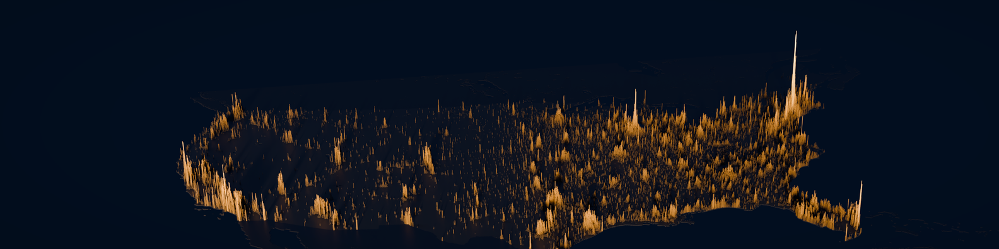
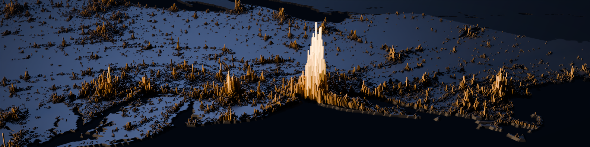

# Population Spikes: a 3D population-density banner of the United States



## Description

Population Spikes is a reproducible pipeline that turns gridded population data into a 3D "spike map" of the contiguous United States: tall columns where people are concentrated, flat land where they aren't. It is meant to make the extreme unevenness of where Americans live visible at a glance, in a wide banner format suited to a LinkedIn or web header.

The project covers the whole path from raw data to finished image:

1. **Data:** download WorldPop 2020 population counts, U.S. Census state totals and Natural Earth boundaries.
2. **Processing:** clean, calibrate and re-grid the counts onto an equal-area 2.5 km grid, then convert them to density.
3. **Rendering:** turn densities into column heights, build the mesh in Blender and render it with Cycles.

Every image is defined by a YAML config, so any look (palette, camera, lighting, height transform) can be reproduced or varied from the command line. Methods and validation are documented in [docs/](docs/).

### The banner

Every column is a 2.5 km cell of the contiguous United States. Its height is proportional to population density (people/km² of land) raised to the power 0.68. That's 113,201 columns built from WorldPop 2020, calibrated to the 2020 Census state totals, projected to USA Contiguous Albers Equal Area and rendered in Blender Cycles. Canada, Mexico and the Caribbean appear as land silhouettes for context.

**Alternate: Northeast Corridor close-up** (Washington to Boston, seen from over the Atlantic; [config](config/experiments/44_northeast_corridor.yaml)):



The banner above is [config/experiments/84_final_gold_navy_tint1.yaml](config/experiments/84_final_gold_navy_tint1.yaml). Rendering it writes the 1584×396 PNG/JPG, the 3168×792 master and a LinkedIn safe-area preview to `renders/final/84_final_gold_navy_tint1/`. Renders aren't committed (they're reproducible and would bloat the history); full-resolution masters are attached to the GitHub Releases.

## How it works

```
WorldPop 1 km counts ──► sanitize hot pixels ──► calibrate to Census 2020 state totals
        ──► conserve-sum binning into EPSG:5070 2.5 km grid ──► ÷ land area = density
        ──► height = (ρ / ρ_Manhattan)^0.68 ──► numpy-built meshes in Blender ──► Cycles ──► banner
```

- **Accurate:** after calibration the gridded CONUS total is within 0.6% of the Census, with a 0.6% mean state error. Population is conserved exactly through reprojection. All corrections are logged. See [docs/METHODS.md](docs/METHODS.md).
- **Reproducible:** every image is defined by a YAML config, and the folder it renders into stores the merged config. Raw inputs are checksummed in a manifest.
- **Explored:** 31 experiment configs cover geometry, transforms, exaggeration, camera, lighting and palette. Contact sheets and verdicts are in [docs/EXPERIMENTS.md](docs/EXPERIMENTS.md).

## Requirements

- Python 3.12 (as built; dependencies in [requirements.txt](requirements.txt); exact versions in [requirements.lock.txt](requirements.lock.txt))
- [Blender](https://www.blender.org/) 4.2+
- About 900 MB of disk for downloaded data (outside the repo); a GPU is optional

## Quick start (Windows, as built; any OS works)

```powershell
python -m venv .venv
.\.venv\Scripts\python -m pip install -r requirements.txt     # requirements.lock.txt pins exact versions
winget install BlenderFoundation.Blender                       # Blender 4.2+ (built with 5.2)

$env:PYTHONPATH = "src"
.\.venv\Scripts\python -m popspike download                                # ~900 MB into ~/popspike_data
.\.venv\Scripts\python -m popspike preprocess --set grid.resolution_m=2500
.\.venv\Scripts\python -m popspike validate   --set grid.resolution_m=2500
.\.venv\Scripts\python scripts\run_experiments.py "config/experiments/84_final_gold_navy_tint1.yaml" --force
```

With a recent GPU the final render takes well under a minute end to end. Without a supported GPU, Cycles falls back to the CPU; lower `render.samples` for speed.

### Making a variant

Copy any experiment YAML, or override inline:

```powershell
.\.venv\Scripts\python -m popspike all --config config/experiments/84_final_gold_navy_tint1.yaml `
    --set name=my_variant render.palette=ice_blue height.power=0.6 render.camera.elevation_deg=30
```

| Knob | Where | Notes |
|---|---|---|
| Resolution | `grid.resolution_m` | Run `preprocess` once per resolution |
| Story | `height.quantity` (`density` / `count`), `height.transform`, `height.power` | |
| Drama | `geometry.max_height`, `render.camera.elevation_deg` | |
| Look | `geometry.type` (`spikes` / `terrain` / `hybrid`), `render.palette` (`blender/palettes.json`), `render.light.preset` | |
| Neighbours | `height.neighbor_scale` | 0 = silhouette only; 1 = true height (faded) |
| Brightness | `render.exposure`, `render.light.strength` | |

Other regions work by changing `grid.extent` and the camera target, as experiment 44 does for DC to Boston. For areas outside North America, also change `data.clip_bbox_lonlat` and `grid.crs`.

## Repository layout

```
config/base.yaml               all defaults, commented
config/experiments/*.yaml      prototype, 31 experiments, finals (80-86)
src/popspike/                  download, preprocess, validate, transform, export_heights, render, compose, cli
blender/build_scene.py         scene builder (runs inside Blender; numpy only)
blender/palettes.json          colour palettes
scripts/run_experiments.py     batch render + contact sheet
docs/                          METHODS, DATA_SOURCES, EXPERIMENTS, validation tables, img/ (curated images)
renders/                       generated output (git-ignored)
```

Data and intermediates (raw downloads, rasters, height bundles, 16-bit renders) live in `~/popspike_data`, never in the repo.

## Credits

Data: WorldPop 2020 (CC BY 4.0), U.S. Census Bureau, Natural Earth. Full citations are in [docs/DATA_SOURCES.md](docs/DATA_SOURCES.md). Inspired by Alasdair Rae's population spike maps and The Pudding's *Human Terrain*. All code and renders in this repo are original.
